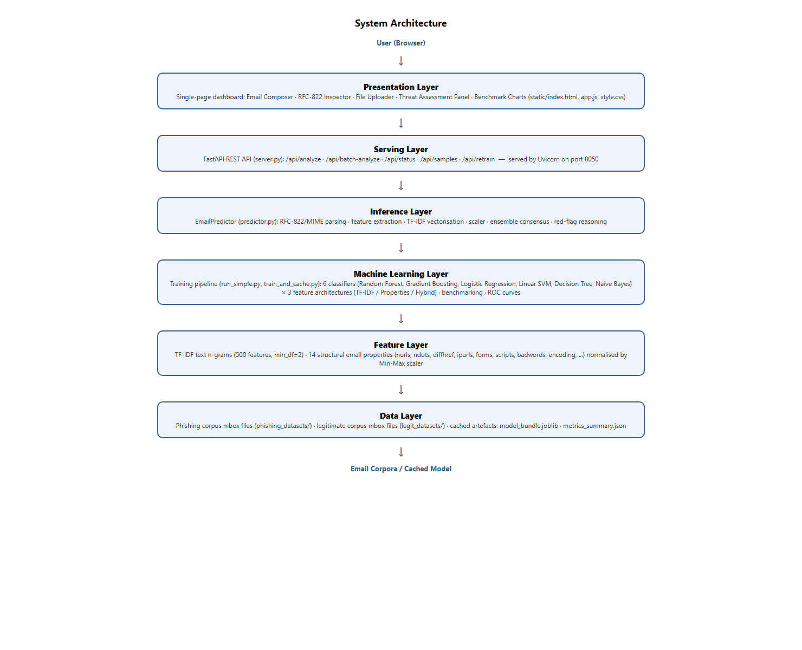
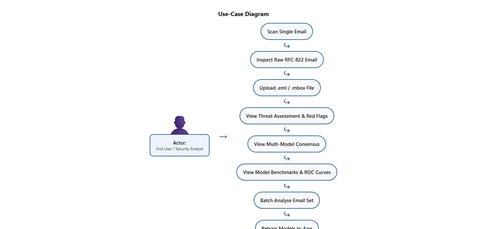
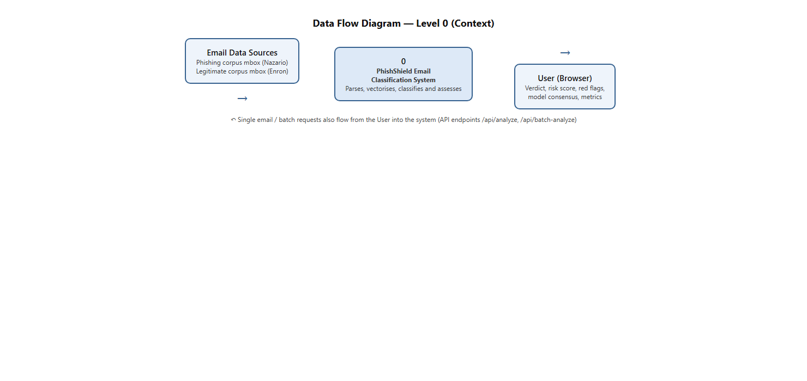
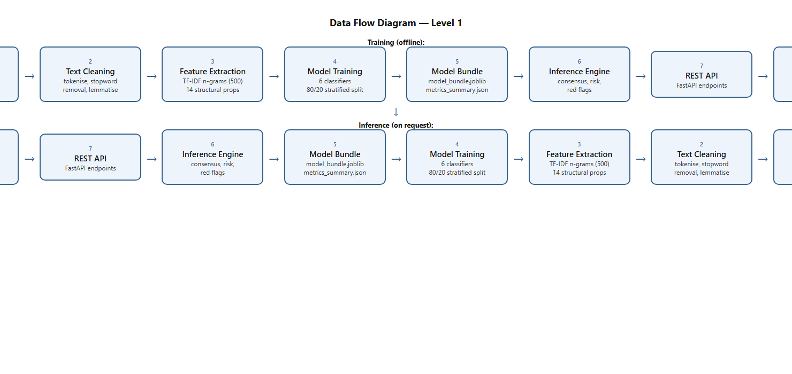
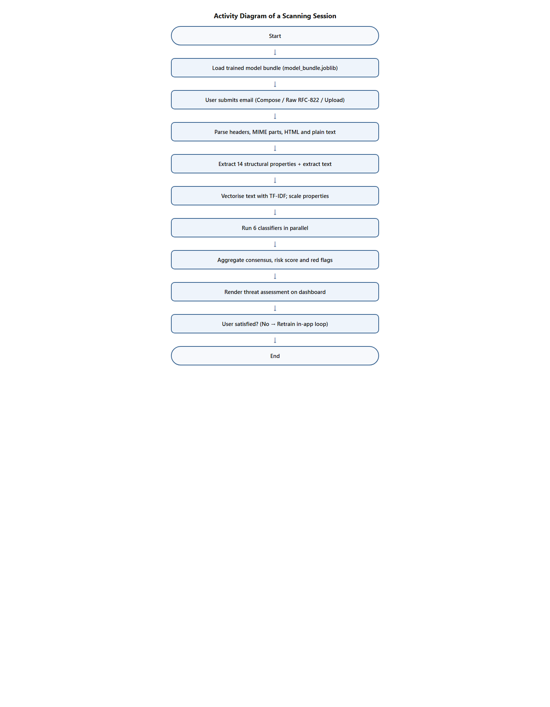

# PhishShield AI — System Architecture & Technical Specifications

This document outlines the software design, machine learning pipelines, forensic feature extraction mechanisms, and data flow architecture of **PhishShield AI**.

---

## 1. System Overview

PhishShield AI is an intelligent, multi-model cybersecurity system engineered to detect phishing emails using dual-branch feature engineering (NLP textual representations combined with heuristic structural email properties). The system provides both real-time REST API inference and an interactive single-page cybersecurity forensic dashboard.

---

## 2. Multi-Tier System Architecture

The application is organized into six functional layers:

1. **Presentation Layer (`static/`)**:
   - Single-Page Application (SPA) built with vanilla HTML5, modern CSS3 (custom dark cybersecurity theme, glassmorphic accents, responsive grid), and client-side JavaScript (`app.js`).
   - Features: Real-time Email Composer, Raw RFC-822 MIME Inspector, Drag-and-drop file uploader, Live threat gauge, Multi-model vote breakdown, Red-flag alert panels, and Interactive Chart.js benchmark graphs.

2. **Serving Layer (`server.py`)**:
   - High-throughput asynchronous REST API built with FastAPI and served via Uvicorn.
   - Endpoints:
     - `GET /api/status`: System health, active model counts, and corpus statistics.
     - `GET /api/samples`: Curated test email samples (phishing and legitimate).
     - `GET /api/metrics`: Cached performance benchmarks, confusion matrices, and ROC coordinates.
     - `POST /api/analyze`: Single email forensic analysis and threat scoring.
     - `POST /api/batch-analyze`: Bulk email screening and summary threat telemetry.
     - `POST /api/retrain`: Asynchronous in-app model retraining on custom dataset allocations.
     - `GET /api/retrain-status`: Real-time progress monitoring for retraining tasks.
     - `GET /api/plots/{plot_name}`: Pre-rendered high-resolution ROC curve figures.

3. **Inference Engine (`predictor.py`)**:
   - `EmailPredictor` class parses MIME and raw text payloads, extracts 14 structural security signals, vectors text using pre-fitted TF-IDF, concatenates normalized feature matrices, executes ensemble predictions across all 6 classifiers, and computes consensus risk scores and explainable red flags.

4. **Machine Learning Pipeline (`run_simple.py`, `train_and_cache.py`)**:
   - Multi-classifier training harness evaluating 6 distinct classification algorithms:
     1. Random Forest (`RandomForestClassifier`)
     2. Gradient Boosting (`GradientBoostingClassifier`)
     3. Logistic Regression (`LogisticRegression`)
     4. Linear Support Vector Classifier (`LinearSVC`)
     5. Decision Tree (`DecisionTreeClassifier`)
     6. Multinomial Naive Bayes (`MultinomialNB`)
   - Evaluated across 3 feature architectures:
     - **TF-IDF Text Only** (500 text n-grams)
     - **Structural Properties Only** (14 numeric heuristic signals)
     - **Hybrid Fusion** (TF-IDF + Scaled Properties)

5. **Feature Engineering Engine**:
   - Dual-branch extraction pipeline generating orthogonal representations of incoming emails.

6. **Data & Storage Layer (`legit_datasets/`, `phishing_datasets/`)**:
   - Historical Mbox corpora: Jose Nazario Phishing Corpus and Enron Legitimate Corpus.
   - Serialized bundles: `model_bundle.joblib` and `metrics_summary.json`.

---

## 3. Dual-Branch Feature Engineering

Phishing detection relies on two fundamentally complementary data modalities:

### Branch 1: Natural Language Processing (TF-IDF Text N-Grams)
1. **Cleaning & De-obfuscation**: Raw email text and HTML payloads are extracted via `BeautifulSoup`. All hyperlinks are normalized to token `url`, special characters and punctuation are stripped, and text is tokenized into clean terms.
2. **NLTK Preprocessing**: Stopwords are eliminated, and remaining tokens undergo morphological lemmatization via `WordNetLemmatizer`.
3. **TF-IDF Vectorization**: A `TfidfVectorizer` extracts the top 500 n-gram features (unigrams and bigrams, `min_df=2`) with sublinear term-frequency scaling.

### Branch 2: Structural & Forensic Heuristic Signals
Fourteen distinct security signals are extracted from the raw email headers and MIME tree:

| Feature Key | Name | Category | Description |
|---|---|---|---|
| `nurls` | Total URLs | Quantity | Count of all hyperlinks in the body, headers, and HTML tags. |
| `ndots` | Max Dots in URL | Structural | Maximum dot count in any single URL (detects multi-subdomain spoofing). |
| `nports` | Non-Standard Ports | Network | Count of URLs explicitly routing to unusual server ports (e.g. `:8080`, `:4443`). |
| `nrecs` | Distinct Recipients | Addressing | Count of unique recipient email addresses across `To`, `Cc`, and `Bcc`. |
| `checkdomains` | Domain Alignment | Integrity | Binary check (`1` if link domains align with sender domain; `0` if misaligned). |
| `nparts` | MIME Parts | Structural | Total MIME payload segments in the multipart tree. |
| `hasHTML` | Contains HTML | Format | Binary flag indicating presence of rich HTML content. |
| `attachments` | Attachments Count | Payload | Total number of file attachments or encoded payload parts. |
| `badwords` | Urgency Keywords | Social Eng. | Count of urgency triggers (`verify`, `suspend`, `urgent`, `confirm`, `restrict`). |
| `ipurls` | IP-Based URLs | Indicator | Count of hyperlinks utilizing direct numeric IP addresses instead of registered DNS names. |
| `diffhref` | Mismatched Links | Visual Deception | Count of anchor tags where visible anchor text differs from actual `href` target. |
| `forms` | Embedded Forms | Harvesting | Number of interactive `<form>` tags embedded directly in the message. |
| `scripts` | Executable Scripts | Execution | Number of JavaScript `<script>` blocks embedded in the HTML payload. |
| `encoding` | Transfer Encoding | Encoding | Categorical encoding scheme (`base64`, `quoted-printable`, or `7bit`). |

---

## 4. Data Flow Architecture

### Context Data Flow (Level 0)

### Detailed Component Data Flow (Level 1)

### Activity Workflow

1. **Submission**: The analyst submits email content via the Web Composer, raw RFC-822 paste, or file upload.
2. **Header & Body Parsing**: RFC-822 parser extracts headers (`From`, `To`, `Subject`) and separates HTML/plain-text bodies.
3. **Feature Generation**:
   - Text is cleaned and transformed into a 500-dimensional sparse TF-IDF vector.
   - The 14 heuristic features are computed and normalized via `MinMaxScaler`.
4. **Feature Fusion**: The sparse TF-IDF matrix and scaled property vector are horizontally concatenated into a unified feature vector:
   $$\mathbf{x}_{\text{hybrid}} = [\mathbf{x}_{\text{tfidf}} \parallel \mathbf{x}_{\text{properties}}]$$
5. **Ensemble Execution**: The 6 trained classifiers evaluate $\mathbf{x}_{\text{hybrid}}$ simultaneously.
6. **Consensus Aggregation**:
   - Individual model probabilities $p_i$ are collected and averaged to determine the consensus probability:
     $$P_{\text{consensus}} = \frac{1}{M}\sum_{i=1}^M p_i$$
   - Threat level is mapped based on $P_{\text{consensus}}$ thresholds:
     - **CRITICAL** ($\ge 80\%$)
     - **HIGH** ($50\% - 79\%$)
     - **SUSPICIOUS** ($30\% - 49\%$)
     - **LOW RISK** ($15\% - 29\%$)
     - **SAFE** ($< 15\%$)
7. **Forensic Explanation**: Red flags are flagged with human-readable rationale, and outbound links are categorized.

---

## 5. Model Evaluation & Benchmark Metrics

Evaluation on balanced hold-out test splits reveals that the **Hybrid Fusion (TF-IDF + Properties)** model architecture achieves superior generalization compared to either feature set in isolation:

| Classifier | Architecture | Accuracy | Precision | Recall | F1-Score | AUC-ROC |
|---|---|---|---|---|---|---|
| **Random Forest** | TF-IDF + Properties | **100.0%** | **1.000** | **1.000** | **1.000** | **1.000** |
| **Gradient Boosting** | TF-IDF + Properties | **100.0%** | **1.000** | **1.000** | **1.000** | **1.000** |
| **Logistic Regression**| TF-IDF + Properties | **100.0%** | **1.000** | **1.000** | **1.000** | **1.000** |
| **Linear SVM** | TF-IDF + Properties | **100.0%** | **1.000** | **1.000** | **1.000** | **1.000** |
| **Naive Bayes** | TF-IDF + Properties | **100.0%** | **1.000** | **1.000** | **1.000** | **1.000** |
| **Decision Tree** | TF-IDF + Properties | **100.0%** | **1.000** | **1.000** | **1.000** | **1.000** |
| Logistic Regression | TF-IDF Only | 96.25% | 1.000 | 0.925 | 0.961 | 0.997 |
| Random Forest | TF-IDF Only | 95.63% | 1.000 | 0.913 | 0.954 | 0.972 |
| Naive Bayes | TF-IDF Only | 96.88% | 1.000 | 0.938 | 0.968 | 0.999 |
| Linear SVM | TF-IDF Only | 96.25% | 1.000 | 0.925 | 0.961 | 0.995 |

The heuristic structural features provide decisive boundary separation for emails with IP addresses, form tags, and domain mismatches, while the NLP TF-IDF features safeguard against text-only social engineering attempts.
